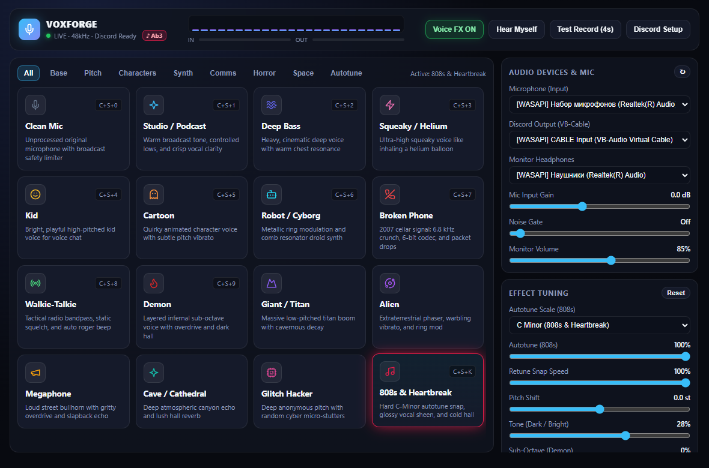

# VoxForge — Real-Time Voice Changer for Discord

**VoxForge** is a lightweight, low-latency, open-source real-time voice changer built for **Discord** and Windows voice chat. It runs 100% locally in Python with custom real-time DSP (phase-aligned dual-tap pitch shifting, MPM hard-snap autotune, stateful biquad EQ, ring modulation, comb resonance, bitcrushing, and WASAPI ASRC buffering) and a modern desktop UI.



## Features

- **16 Ready-to-Use Voice Presets** — from Deep Bass, Kid, and Squeaky Helium to Robot, Broken Phone, Walkie-Talkie (with live roger beep), Demon, Cave, and **808s & Heartbreak** hard autotune.
- **Real-Time Hard Autotune (808s Style)** — MPM (Normalized Square Difference) pitch tracker with instant musical-scale quantization (`C Minor`, `Minor Pentatonic`, `C Major`, `Chromatic`) and a live locked-note indicator (`♪ D3`, `♪ Eb3`, etc.).
- **Low-Latency WASAPI Engine** — 48 kHz / 480-sample (10 ms) native Windows WASAPI quantum with a sample-level `RingAudioFIFO` and gentle ASRC clock-drift compensation to eliminate stuttering between USB mics and virtual audio cables.
- **Live Effect Mixer** — tweak pitch, tone tilt, autotune strength/speed, sub-octave, ring mod, metallic comb, overdrive, signal dropouts, bit depth, echo, and reverb in real time.
- **Hear Myself & 4-Second Loopback Test** — preview voices live on headphones or record a 4-second echo-free clip to hear exactly how you sound in Discord.
- **Global Hotkeys** — switch presets or bypass effects mid-game without alt-tabbing (`Ctrl+Shift+0..9`, `Ctrl+Shift+K`, `Ctrl+Shift+M`).
- **1-Click VB-Cable Helper** — detects `VB-Cable` automatically and provides a built-in installer helper for routing processed audio into Discord.

## Voice Presets

| Preset | Category | Hotkey | Highlights |
| --- | --- | --- | --- |
| **Clean Mic** | Base | `Ctrl+Shift+0` | Original microphone with broadcast soft limiter |
| **Studio / Podcast** | Base | `Ctrl+Shift+1` | Warm broadcast EQ and clarity presence |
| **Deep Bass** | Pitch | `Ctrl+Shift+2` | `-4.6 st` deep voice with warm chest resonance |
| **Squeaky / Helium** | Pitch | `Ctrl+Shift+3` | `+9.2 st` high-pitched helium balloon voice |
| **Kid** | Characters | `Ctrl+Shift+4` | `+5.6 st` bright playful kid timbre |
| **Cartoon** | Characters | `Ctrl+Shift+5` | `+7.4 st` animated character with subtle vibrato |
| **Robot / Cyborg** | Synth | `Ctrl+Shift+6` | Ring modulator (`58 Hz`) + metallic comb resonator |
| **Broken Phone** | Comms | `Ctrl+Shift+7` | `6.8 kHz` sample crunch, 6-bit mu-law, and random GSM dropouts |
| **Walkie-Talkie** | Comms | `Ctrl+Shift+8` | Tactical radio bandpass, gated static hiss, and two-tone roger beep |
| **Demon** | Horror | `Ctrl+Shift+9` | Layered `-4.8 st` + `-11 st` sub-octave with overdrive and dark hall |
| **Giant / Titan** | Characters | — | `-7.6 st` massive booming titan voice |
| **Alien** | Synth | — | Phaser, warbling vibrato, and extraterrestrial ring mod |
| **Megaphone** | Comms | — | Horn bandpass, heavy overdrive, and slapback echo |
| **Cave / Cathedral** | Space | — | Deep canyon echo and lush hall reverb |
| **Glitch Hacker** | Synth | — | Deep anonymous pitch with random cyber micro-stutters |
| **808s & Heartbreak** | Autotune | `Ctrl+Shift+K` | Hard C-Minor autotune snap, glossy vocal presence, and cold hall |

## Quick Start (Windows)

### 1. Clone & Install

```bash
git clone https://github.com/DmytroZam/voxforge.git
cd voxforge
python -m venv .venv
.venv\Scripts\pip install -r requirements.txt
```

### 2. Run VoxForge

Double-click **`VoxForge.vbs`** (silent launch, no console window) or **`Start_VoiceMod.bat`**, or run from terminal:

```bash
.venv\Scripts\python.exe main.py
```

### 3. Connect to Discord

1. Install **[VB-Cable](https://vb-audio.com/Cable/)** (or click **Install VB-Cable (1-Click)** inside the VoxForge banner if it is not installed yet).
2. In **VoxForge**, select your real mic under **Microphone (Input)** and **`CABLE Input (VB-Audio Virtual Cable)`** under **Discord Output (VB-Cable)**.
3. In **Discord → Settings → Voice & Video**, set **Input Device** to **`CABLE Output (VB-Audio Virtual Cable)`**.
4. **Recommended:** Disable **Krisp** noise suppression in Discord (and set Input Sensitivity manually) so Discord does not filter out Autotune, Robot, Walkie-Talkie, or Broken Phone effects.

## Global Hotkeys

- `Ctrl + Shift + 0..9` — Switch voice presets
- `Ctrl + Shift + K` — Activate **808s & Heartbreak** autotune
- `Ctrl + Shift + M` — Toggle Voice FX On / Off (bypass)

## Project Structure

```text
├── main.py                # App entry point (local server + native Edge/Chrome app window)
├── Start_VoiceMod.bat     # Portable Windows launcher
├── VoxForge.vbs           # Silent Windows launcher (no console window)
├── requirements.txt       # Python dependencies
└── app/
    ├── dsp.py             # Real-time DSP chain (pitch shifter, MPM autotune, EQ, FX)
    ├── presets.py         # 16 curated voice presets & parameter schema
    ├── audio_engine.py    # WASAPI audio router, RingAudioFIFO + ASRC, 4s test recorder
    ├── hotkeys.py         # Global Windows hotkeys via pynput
    ├── vbcable.py         # VB-Cable detection & 1-click installer helper
    ├── server.py          # FastAPI REST + 30 FPS WebSocket telemetry backend
    └── static/
        └── index.html     # Self-contained dark desktop UI (zero external CDNs)
```

## License

MIT — see [LICENSE](LICENSE).
